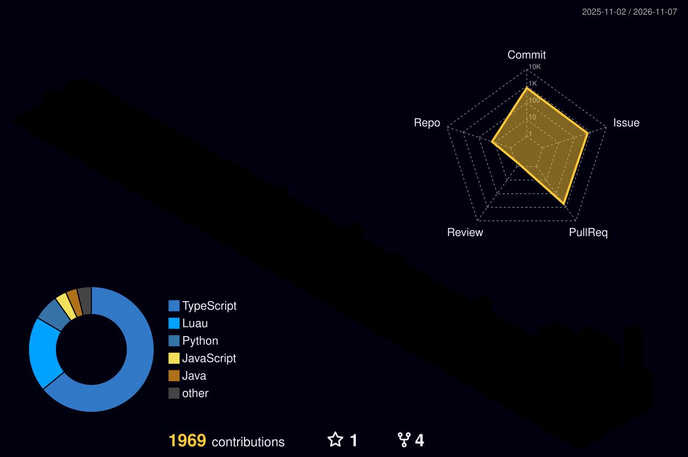

# Hi, I'm Jackson Yanek 👋

---

## 🧑‍💻 About Me

- 💼 **Software Engineer** at **Vixxo** in Scottsdale, AZ
- 🎓 **B.S. Computer Science**, University of Kansas (May 2026)
- 🏎️ Former **Undergraduate Research Assistant** in KU's Computer Systems Lab under Prof. Heechul Yun, building edge ML for autonomous racing
- 🏁 Former **Vice President of the KU F1Tenth Club**: represented KU at **IROS 2024 (🥉 3rd place)** and **ICRA 2026 (4th place)**
- 🛠️ Former **I.T. Technician** for the City of Lawrence: 260+ tickets closed for an 800+ employee base
- 🤖 Interests: embedded systems, autonomous vehicles, machine learning, software engineering

## 🧰 Tech Stack

  

## 🚀 Featured Project

  

> **TLN Variants**: a ROS 2 package for building and testing end-to-end CNN driving models on a RoboRacer / F1Tenth platform, deployed via TFLite on constrained hardware.

## 📊 GitHub Stats

  
  

## 🏙️ Contributions in 3D

  <picture>
    <source media="(prefers-color-scheme: dark)" srcset="https://raw.githubusercontent.com/traxon99/traxon99/output/profile-night-rainbow.svg" />
    <source media="(prefers-color-scheme: light)" srcset="https://raw.githubusercontent.com/traxon99/traxon99/output/profile-season-animate.svg" />
    
  </picture>

## 🐍 Contribution Snake

  <picture>
    <source media="(prefers-color-scheme: dark)" srcset="https://raw.githubusercontent.com/traxon99/traxon99/output/snake-dark.svg" />
    <source media="(prefers-color-scheme: light)" srcset="https://raw.githubusercontent.com/traxon99/traxon99/output/snake.svg" />
    
  </picture>

*Always happy to talk autonomous vehicles, embedded systems, or ML. Feel free to reach out!*

